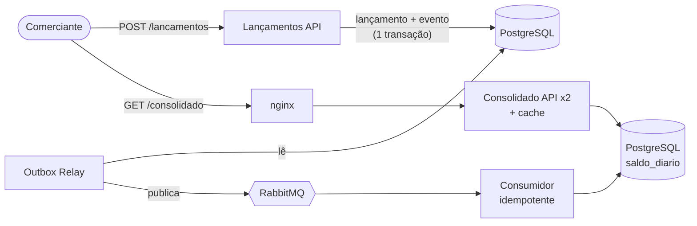

# Fluxo de Caixa – Lançamentos e Consolidado Diário

Solução para o desafio de Arquiteto de Soluções: um comerciante registra os **débitos e créditos** do dia e consulta o **saldo diário consolidado**.

**Em uma frase:** dois microsserviços independentes que se comunicam só por **eventos assíncronos**, com **Transactional Outbox** para não perder nenhum lançamento e um **modelo de leitura pré-calculado (CQRS)** para o consolidado aguentar o pico. Se o consolidado cair, os lançamentos continuam funcionando.



## Sumário

| Documento | Conteúdo |
| --- | --- |
| [1. Domínios e capacidades](docs/01-dominios-e-capacidades.md) | Capacidades de negócio, subdomínios (DDD), context map, linguagem ubíqua, modelo de domínio |
| [2. Requisitos](docs/02-requisitos.md) | Requisitos funcionais e não funcionais refinados, com critério de aceite e rastreabilidade |
| [3. Arquitetura alvo](docs/03-arquitetura-alvo.md) | C4, sequência, escalabilidade, resiliência, integração, implantação na AWS |
| [4. Arquitetura de transição](docs/04-arquitetura-transicao.md) | Migração de um legado com Strangler Fig, em ondas com critério de saída |
| [5. Custos](docs/05-custos.md) | Estimativa de infraestrutura e licenças, com fontes |
| [6. Observabilidade](docs/06-observabilidade.md) | Métricas, logs, correlation id, alertas |
| [7. Segurança](docs/07-seguranca.md) | Controles implementados e critérios para consumir os serviços |
| [8. Evoluções](docs/08-evolucoes.md) | O que eu faria com mais tempo |
| [ADRs](docs/adr/) | 7 decisões de arquitetura com alternativas e consequências |
| [Contrato do evento](docs/contratos/lancamento-registrado.v1.schema.json) | JSON Schema do `LancamentoRegistrado v1` |

## Como os requisitos do enunciado foram atendidos

| Requisito | Onde |
| --- | --- |
| Serviço de controle de lançamentos | `services/lancamentos` |
| Serviço do consolidado diário | `services/consolidado` |
| Mapeamento de domínios e capacidades | [docs/01](docs/01-dominios-e-capacidades.md) |
| Refinamento de requisitos funcionais e não funcionais | [docs/02](docs/02-requisitos.md) |
| Desenho da arquitetura alvo | [docs/03](docs/03-arquitetura-alvo.md) |
| Justificativa de tecnologias e tipo de arquitetura | [docs/03 §3.5](docs/03-arquitetura-alvo.md#35-por-que-esta-arquitetura-resumo-das-decisões) e [ADRs](docs/adr/) |
| Testes | `services/*/tests` (unitários, integração com banco, API), `scripts/smoke_test.py`, `loadtest/` |
| Lançamentos não cai se o consolidado cair | Outbox + fila durável; demonstração em `scripts/teste_resiliencia.sh` |
| Consolidado: 50 req/s com ≤ 5% de perda | CQRS + cache + 2 réplicas; medição em `loadtest/carga_consolidado.py` |
| *Diferencial:* arquitetura de transição | [docs/04](docs/04-arquitetura-transicao.md) |
| *Diferencial:* custos | [docs/05](docs/05-custos.md) |
| *Diferencial:* monitoramento e observabilidade | [docs/06](docs/06-observabilidade.md) + Prometheus no compose |
| *Diferencial:* segurança no consumo de serviços | [docs/07](docs/07-seguranca.md) |

## Como rodar localmente

### Pré-requisitos

- [Docker Desktop](https://www.docker.com/products/docker-desktop/) (ou Docker Engine + Compose v2)
- Python 3.10+ (só para os scripts de teste ponta a ponta e de carga; eles não precisam de bibliotecas extras)

### 1. Subir tudo

```bash
docker compose up --build -d
```

| Serviço | Endereço |
| --- | --- |
| Lançamentos (Swagger) | http://localhost:8001/docs |
| Consolidado (Swagger, via nginx) | http://localhost:8002/docs |
| RabbitMQ (painel) | http://localhost:15672 (usuário `guest`, senha `guest`) |
| Prometheus | http://localhost:9090 |

Chaves de API locais: `dev-key-lancamentos` e `dev-key-consolidado` (no Swagger, clique em **Try it out** e preencha o campo `X-API-Key`).

### 2. Usar

```bash
# Registrar um crédito
curl -X POST http://localhost:8001/api/v1/lancamentos \
  -H "X-API-Key: dev-key-lancamentos" -H "Content-Type: application/json" \
  -H "Idempotency-Key: venda-0001" \
  -d '{"tipo": "CREDITO", "valor": "150.75", "descricao": "Venda balcão"}'

# Registrar um débito
curl -X POST http://localhost:8001/api/v1/lancamentos \
  -H "X-API-Key: dev-key-lancamentos" -H "Content-Type: application/json" \
  -d '{"tipo": "DEBITO", "valor": "42.00", "descricao": "Embalagens"}'

# Estornar um lançamento (troque o ID)
curl -X POST http://localhost:8001/api/v1/lancamentos/<ID>/estorno \
  -H "X-API-Key: dev-key-lancamentos" -H "Content-Type: application/json" \
  -d '{"motivo": "valor digitado errado"}'

# Saldo consolidado de hoje (Linux/Mac; no Windows troque $(date +%F) pela data AAAA-MM-DD)
curl -H "X-API-Key: dev-key-consolidado" \
  http://localhost:8002/api/v1/consolidado/diario/$(date +%F)

# Saldos de um período
curl -H "X-API-Key: dev-key-consolidado" \
  "http://localhost:8002/api/v1/consolidado/diario?inicio=2026-11-01&fim=2026-11-30"
```

Exemplo de resposta do consolidado:

```json
{"data": "2026-11-13", "total_creditos": "150.75", "total_debitos": "42.00",
 "saldo": "108.75", "quantidade_lancamentos": 2, "atualizado_em": "2026-11-13T14:02:11.410000Z"}
```

### 3. Testar

```bash
# Testes automatizados de cada serviço (dentro dos contêineres)
docker compose run --rm lancamentos-api pytest -v
docker compose run --rm consolidado-consumer pytest -v

# Teste ponta a ponta: lança, espera o consolidado refletir, estorna, confere
python scripts/smoke_test.py

# Requisito não funcional: 50 req/s por 60 s, perda máxima de 5%
python loadtest/carga_consolidado.py --rps 50 --segundos 60

# Requisito de resiliência: derruba o consolidado e continua lançando (Linux/Mac/Git Bash)
./scripts/teste_resiliencia.sh
```

Sem Docker, os testes também rodam direto com Python (usam SQLite em arquivo temporário):

```bash
cd services/lancamentos && pip install -r requirements-dev.txt && pytest
cd ../consolidado && pip install -r requirements-dev.txt && pytest
```

O pipeline de CI (`.github/workflows/ci.yml`) roda os testes dos dois serviços, sobe o ambiente com Docker Compose e executa o teste ponta a ponta e o de carga a cada push.

### 4. Desligar

```bash
docker compose down        # mantém os dados
docker compose down -v     # apaga os dados
```

## API

### Lançamentos (`:8001`)

| Método | Rota | Descrição | Respostas |
| --- | --- | --- | --- |
| POST | `/api/v1/lancamentos` | Registra crédito ou débito. Header opcional `Idempotency-Key` | 201, 200 (repetição), 401, 409, 422 |
| POST | `/api/v1/lancamentos/{id}/estorno` | Estorna (cria lançamento oposto) | 201, 404, 409 |
| GET | `/api/v1/lancamentos/{id}` | Consulta um lançamento | 200, 404 |
| GET | `/api/v1/lancamentos?data=AAAA-MM-DD` | Lista os lançamentos do dia (`limite`, `offset`) | 200 |

### Consolidado (`:8002`)

| Método | Rota | Descrição |
| --- | --- | --- |
| GET | `/api/v1/consolidado/diario/{data}` | Créditos, débitos, saldo e quantidade do dia |
| GET | `/api/v1/consolidado/diario?inicio=&fim=` | Um item por dia do período (até 93 dias) |

Ambos expõem `/health/live`, `/health/ready` e `/metrics`.

## Estrutura do repositório

```
├── docker-compose.yml          ambiente local completo
├── services/
│   ├── lancamentos/
│   │   ├── app/
│   │   │   ├── domain.py        regras de negócio (sem framework)
│   │   │   ├── service.py       casos de uso
│   │   │   ├── repository.py    persistência + outbox
│   │   │   ├── outbox_relay.py  publica eventos no RabbitMQ
│   │   │   ├── api.py           HTTP (FastAPI)
│   │   │   └── db.py, schemas.py, observability.py
│   │   └── tests/
│   └── consolidado/
│       ├── app/
│       │   ├── domain.py        evento + saldo diário
│       │   ├── service.py       casos de uso + cache
│       │   ├── repository.py    UPSERT idempotente
│       │   ├── consumer.py      consumidor RabbitMQ (ack, retry, DLQ)
│       │   └── api.py
│       └── tests/
├── infra/                      nginx (balanceador) e Prometheus
├── scripts/                    teste ponta a ponta e de resiliência
├── loadtest/                   teste de carga do requisito de 50 req/s
└── docs/                       arquitetura, ADRs e contratos
```

## Principais decisões, em resumo

1. **Microsserviços por bounded context**, cada um com seu banco: isolamento de falha e escala independente ([ADR-0001](docs/adr/0001-microsservicos-separados.md)).
2. **Evento + Transactional Outbox** em vez de chamada HTTP: o lançamento nunca depende do consolidado e nenhum evento se perde ([ADR-0002](docs/adr/0002-comunicacao-assincrona-outbox.md)).
3. **CQRS**: o saldo do dia é pré-calculado; consultar é ler uma linha ([ADR-0003](docs/adr/0003-cqrs-modelo-de-leitura.md)).
4. **Idempotência ponta a ponta**: `Idempotency-Key` na API e `event_id` no consumidor ([ADR-0007](docs/adr/0007-idempotencia.md)).
5. **Arquitetura hexagonal**: regras de negócio isoladas de banco, fila e HTTP, o que torna tudo testável e substituível ([ADR-0006](docs/adr/0006-stack-python-fastapi-postgres.md)).
6. **Dinheiro em centavos** e **lançamentos imutáveis** (correção por estorno): exatidão e trilha de auditoria.
