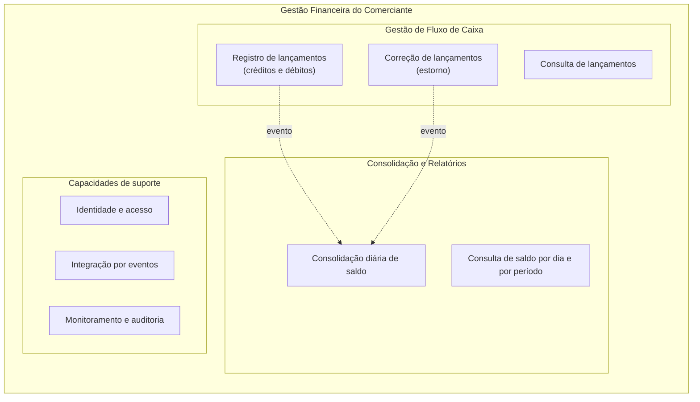
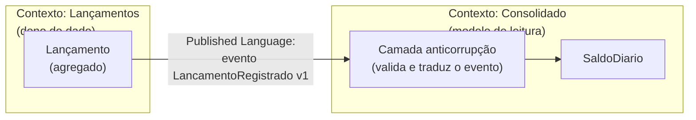
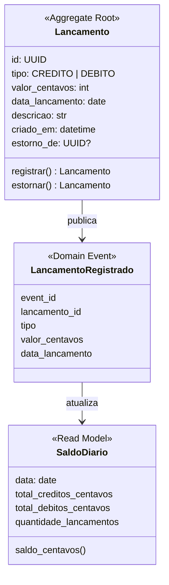

# 1. Domínios funcionais e capacidades de negócio

## 1.1 Problema de negócio

Um comerciante precisa:

1. **registrar** o que entra e o que sai do caixa no dia a dia (créditos e débitos);
2. **consultar** o saldo consolidado de cada dia, para saber se o dia fechou positivo ou negativo.

As duas necessidades têm **perfis muito diferentes**, e essa diferença guia toda a arquitetura:

| Característica | Registrar lançamentos | Consultar consolidado |
| --- | --- | --- |
| Tipo de operação | Escrita (comando) | Leitura (consulta) |
| Criticidade | Alta: perder um lançamento é perder dinheiro | Média: pode estar alguns segundos atrasado |
| Disponibilidade exigida | Não pode cair, nem se o consolidado cair | Pode degradar sem afetar o registro |
| Carga | Ritmo das vendas do comerciante | Pico de 50 req/s (relatórios, painéis) |
| Consistência | Forte (transacional) | Eventual (segundos) |

## 1.2 Mapa de capacidades de negócio

Capacidade = **o que** o negócio precisa saber fazer, independente de sistema.

| Capacidade | Nível | Classificação | Atendida por |
| --- | --- | --- | --- |
| Registro de lançamentos | 2 | Core (é o coração do negócio) | Serviço de Lançamentos |
| Correção de lançamentos (estorno) | 2 | Core | Serviço de Lançamentos |
| Consulta de lançamentos | 2 | Suporte | Serviço de Lançamentos |
| Consolidação diária de saldo | 2 | Core | Serviço de Consolidado (consumidor) |
| Consulta de saldo diário | 2 | Core | Serviço de Consolidado (API) |
| Identidade e acesso | 2 | Genérica (compra/reuso) | API key no MVP; IdP corporativo no alvo |
| Integração por eventos | 2 | Genérica | RabbitMQ (Amazon MQ no alvo em nuvem) |
| Monitoramento e auditoria | 2 | Genérica | Prometheus, logs JSON, correlation id |

## 1.3 Domínios (DDD estratégico)

| Subdomínio | Tipo | Por quê |
| --- | --- | --- |
| **Lançamentos** | Core | É a fonte da verdade do dinheiro. Regras: valor positivo, data não futura, imutabilidade, estorno. |
| **Consolidado** | Core | É o que o comerciante usa para decidir. Regras: saldo = créditos − débitos, sem contar o mesmo evento duas vezes. |
| **Identidade e acesso** | Genérico | Igual em qualquer sistema: não se constrói, usa-se um provedor. |
| **Observabilidade** | Genérico | Ferramentas de mercado. |

## 1.4 Bounded contexts e context map

- **Lançamentos é upstream** e publica uma *Published Language* (o contrato versionado do evento, em [`contratos/`](contratos/lancamento-registrado.v1.schema.json)).
- **Consolidado é downstream** e não lê o banco de Lançamentos. Ele valida o evento ao recebê-lo (`LancamentoRegistrado.de_mensagem`), o que funciona como uma pequena camada anticorrupção.
- Cada contexto tem **o seu banco** (*database per service*), então nenhum pode quebrar o outro mudando uma tabela.

## 1.5 Linguagem ubíqua

| Termo | Significado |
| --- | --- |
| Lançamento | Registro de um movimento de caixa. Imutável. |
| Crédito | Entrada de dinheiro no caixa (venda, recebimento). |
| Débito | Saída de dinheiro do caixa (compra, pagamento). |
| Data do lançamento | Dia em que o movimento aconteceu (fuso America/Sao_Paulo). Define em qual consolidado ele entra. |
| Estorno | Lançamento de tipo oposto que anula outro. Nunca se apaga o original. |
| Saldo diário | Créditos do dia − débitos do dia. |
| Consolidado | Visão agregada dos saldos por dia. |

## 1.6 Modelo de domínio (DDD tático)

**Invariantes do agregado `Lancamento`** (código em `services/lancamentos/app/domain.py`):

1. valor > 0, no máximo 2 casas decimais, guardado em **centavos** (inteiro) para não ter erro de arredondamento;
2. data não pode estar no futuro (é o fluxo de caixa **realizado**);
3. imutável: correção só por estorno; um lançamento é estornado no máximo uma vez; estorno não é estornável.
