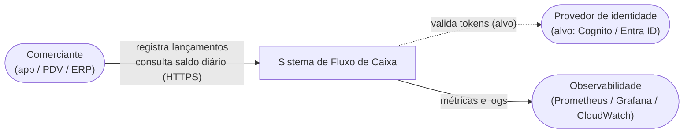
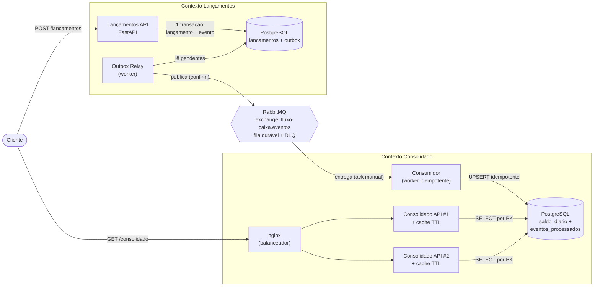
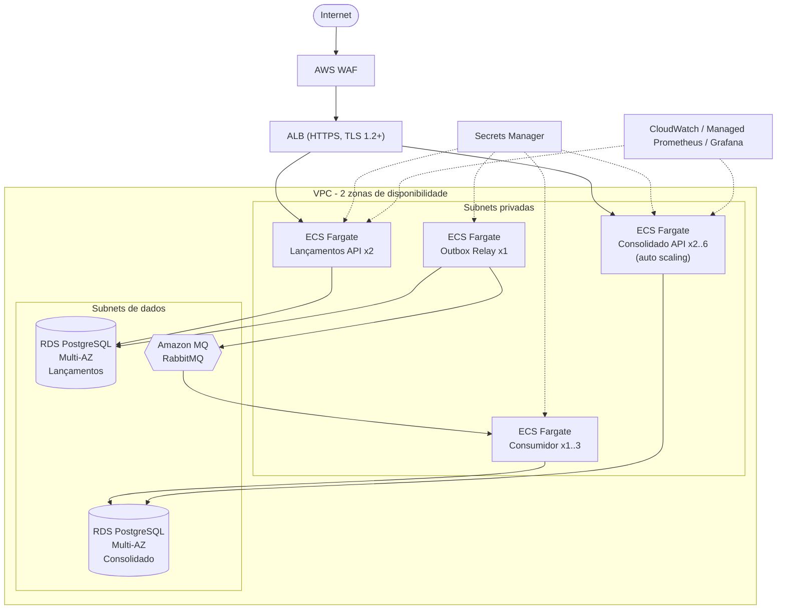

# 3. Arquitetura alvo

## 3.1 Visão geral em uma frase

Dois microsserviços independentes: **Lançamentos** (escrita, fonte da verdade) e **Consolidado** (leitura, modelo pré-calculado). Eles conversam **somente por eventos assíncronos**, com garantia de entrega pelo padrão **Transactional Outbox**. Se o Consolidado cair, o Lançamentos continua funcionando, e os eventos esperam na fila.

## 3.2 Contexto (C4 nível 1)



## 3.3 Containers (C4 nível 2)



| Container | Responsabilidade | Escala | Se cair... |
| --- | --- | --- | --- |
| Lançamentos API | Validar e gravar lançamento + evento | Horizontal (stateless) | Clientes recebem erro; nada é perdido |
| Outbox Relay | Publicar eventos pendentes | Horizontal (`SKIP LOCKED`) | Eventos acumulam no outbox; API segue normal |
| RabbitMQ | Transportar eventos com durabilidade | Cluster (alvo) | Relay tenta de novo; API segue normal |
| Consumidor | Atualizar saldo do dia | Horizontal (idempotente) | Mensagens acumulam na fila |
| Consolidado API | Responder saldos | Horizontal (stateless + cache) | nginx desvia para a outra réplica |

## 3.4 Fluxo de registro (sequência)

```mermaid
sequenceDiagram
    autonumber
    actor C as Comerciante
    participant L as Lançamentos API
    participant DB as PostgreSQL (Lançamentos)
    participant R as Outbox Relay
    participant MQ as RabbitMQ
    participant K as Consumidor
    participant CDB as PostgreSQL (Consolidado)

    C->>L: POST /lancamentos (X-API-Key, Idempotency-Key)
    L->>L: valida regras do domínio
    L->>DB: BEGIN; INSERT lancamento; INSERT outbox; COMMIT
    L-->>C: 201 Created (não espera o consolidado)
    loop a cada 0,5 s
        R->>DB: SELECT pendentes FOR UPDATE SKIP LOCKED
        R->>MQ: publish (persistente, confirm)
        MQ-->>R: ack do broker
        R->>DB: UPDATE outbox SET publicado_em
    end
    MQ->>K: entrega LancamentoRegistrado
    K->>CDB: BEGIN; INSERT eventos_processados ON CONFLICT DO NOTHING
    alt evento novo
        K->>CDB: UPSERT saldo_diario (soma); COMMIT
    else duplicado
        K->>CDB: COMMIT (nada a fazer)
    end
    K-->>MQ: ack
```

## 3.5 Por que esta arquitetura (resumo das decisões)

| Decisão | Alternativa descartada | Motivo | ADR |
| --- | --- | --- | --- |
| 2 microsserviços | Monolito | O requisito pede isolamento de falha e escala diferente para escrita e leitura | [0001](adr/0001-microsservicos-separados.md) |
| Comunicação assíncrona por eventos | Chamada HTTP Lançamentos → Consolidado | HTTP acopla disponibilidade: se o consolidado cai, o lançamento falharia | [0002](adr/0002-comunicacao-assincrona-outbox.md) |
| Transactional Outbox | Publicar direto na fila após o commit | Evita o *dual write*: commit ok + fila fora = evento perdido | [0002](adr/0002-comunicacao-assincrona-outbox.md) |
| CQRS: modelo de leitura pré-calculado | Somar lançamentos a cada consulta | Consulta O(1) por dia, essencial para 50 req/s | [0003](adr/0003-cqrs-modelo-de-leitura.md) |
| Cache TTL em memória | Redis | Mais simples para o MVP; Redis entra com muitas réplicas | [0004](adr/0004-cache.md) |
| RabbitMQ | Kafka / SQS | Filas com ack, DLQ e roteamento prontos; operação simples | [0005](adr/0005-broker-rabbitmq.md) |
| Python + FastAPI + PostgreSQL | Java/.NET; NoSQL | Produtividade, OpenAPI automático; ACID para dinheiro | [0006](adr/0006-stack-python-fastapi-postgres.md) |
| Consumidor idempotente | *Exactly-once* no broker | Exactly-once real é caro e raro; at-least-once + idempotência é o padrão de mercado | [0007](adr/0007-idempotencia.md) |

## 3.6 Requisitos transversais

### Escalabilidade

- APIs **stateless**: qualquer réplica atende qualquer requisição. No compose, o Consolidado roda com **2 réplicas atrás do nginx**; na nuvem, com auto scaling por CPU e requisições.
- **Escrita e leitura escalam separadas** (CQRS): o pico de consultas não disputa recursos com os lançamentos.
- Workers escalam horizontalmente: relays com `FOR UPDATE SKIP LOCKED`, consumidores com idempotência e UPSERT atômico.
- **Cache** de 2 s absorve o pico no mesmo dia; `prefetch` no consumidor limita a pressão no banco (backpressure).

### Resiliência

| Falha | Comportamento |
| --- | --- |
| Consolidado (API, consumidor ou banco) fora | Lançamentos segue 100%; eventos ficam na fila durável |
| RabbitMQ fora | Lançamentos segue 100%; eventos ficam no outbox |
| Erro temporário ao processar evento | Mensagem volta para a fila (nack + requeue) e é reprocessada |
| Evento corrompido / contrato desconhecido | Vai para a DLQ `consolidado.lancamentos.dlq` para análise, sem travar a fila |
| Evento entregue duas vezes | Ignorado (`eventos_processados`) |
| Réplica do Consolidado fora | nginx/ALB desvia (`proxy_next_upstream`, health check) |
| Container caiu | `restart: unless-stopped` (compose) / ECS reinicia (nuvem) |
| Cliente reenvia o POST por timeout | `Idempotency-Key` evita lançamento duplicado |

### Segurança

Ver [07-seguranca.md](07-seguranca.md). Resumo: API key por serviço (MVP) comparada em tempo constante, TLS no balanceador, OAuth2/JWT com IdP no alvo, containers sem root, segredos fora do código, princípio do menor privilégio no broker e nos bancos.

### Integração

| Integração | Protocolo | Formato | Garantia |
| --- | --- | --- | --- |
| Cliente → APIs | HTTPS/REST | JSON, OpenAPI 3 em `/docs` | Idempotency-Key no POST |
| Lançamentos → Consolidado | AMQP 0-9-1 (RabbitMQ) | JSON, contrato versionado ([schema](contratos/lancamento-registrado.v1.schema.json)) | At-least-once + idempotência |

Mudanças no evento: campos novos e opcionais mantêm a versão 1; mudança incompatível gera `event_version: 2`, com os dois formatos publicados durante a migração.

### Observabilidade

Ver [06-observabilidade.md](06-observabilidade.md).

## 3.7 Implantação alvo em nuvem (AWS, região sa-east-1)



O mesmo desenho funciona em Azure (Container Apps, Azure Database for PostgreSQL, Service Bus) ou on-premises (Kubernetes). O código não depende de provedor: banco por URL, broker por URL.

Custos estimados em [05-custos.md](05-custos.md).
