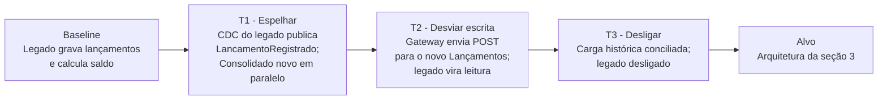
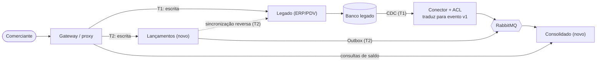

# 4. Arquitetura de transição (migração de legado)

O enunciado não descreve um sistema atual. Como premissa, consideramos o cenário mais comum em comércio: **o comerciante hoje controla o caixa em uma planilha ou em um módulo de um sistema legado (ERP/PDV)**, que grava lançamentos e calcula o saldo do dia com uma consulta pesada no fim do dia.

A migração usa o padrão **Strangler Fig**: o novo sistema cresce em volta do legado e o substitui por partes, **sem big bang** e sempre com caminho de volta.

## 4.1 Ondas

| Onda | O que muda | Critério de saída (só avança se cumprido) | Rollback |
| --- | --- | --- | --- |
| **T1 – Espelhar leitura** | Um conector CDC (ex.: Debezium) lê a tabela do legado e publica o mesmo evento `LancamentoRegistrado v1`. O Consolidado novo roda em paralelo. | Saldo diário do novo = saldo do legado por 30 dias seguidos (conciliação automática) | Desligar o conector; nada muda para o usuário |
| **T2 – Desviar escrita** | Gateway/proxy roteia `POST` para o novo serviço de Lançamentos. Um sincronizador grava de volta no legado para relatórios antigos. | 0 divergência na conciliação diária; erro < 0,1% | Roteamento reversível no gateway |
| **T3 – Desligar legado** | Carga dos lançamentos históricos no novo banco (com `event_id` determinístico, sem duplicar no consolidado). Legado fica só leitura e depois é desligado. | Relatórios históricos batem; usuários sem acesso ao legado por 1 ciclo de fechamento | Reativar o legado em modo leitura |

## 4.2 Arquitetura durante a T1 e a T2

**Por que funciona sem mudar o Consolidado:** ele só conhece o contrato do evento. Não importa se o evento veio do legado (via CDC) ou do serviço novo (via Outbox). A camada anticorrupção do conector traduz o modelo do legado para a linguagem do novo domínio.

## 4.3 Riscos da migração

| Risco | Mitigação |
| --- | --- |
| Dados do legado inconsistentes (valores negativos, sem data) | ACL valida; inválidos vão para a DLQ e para um relatório de saneamento |
| Duplicar lançamentos na carga histórica | `event_id` determinístico (hash do id do legado) + idempotência do consumidor |
| Divergência de regras de arredondamento | Conciliação diária automática na T1 antes de qualquer desvio |
| Usuários resistentes à mudança | T1 é invisível; T2 só muda o destino da escrita |
